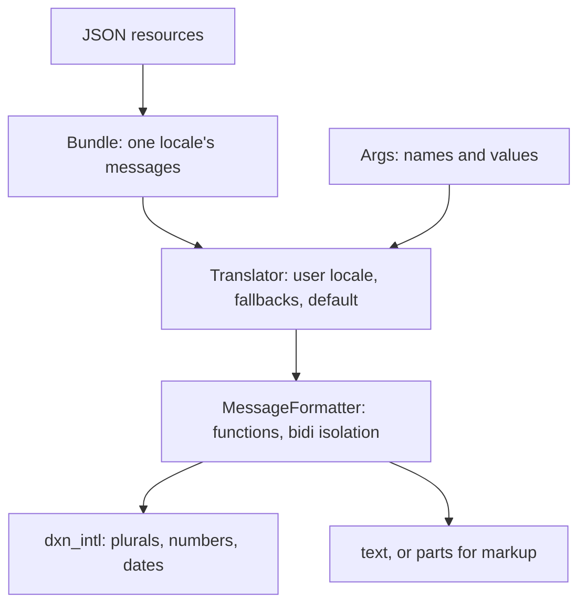

`dxn_i18n` turns [Unicode MessageFormat 2](https://www.unicode.org/reports/tr35/tr35-messageFormat.html) (MF2) messages into text for the user's language. You reach for it when an app has to say "1 item" and "3 items" correctly in every language, show a price or a date the way the user's region writes it, and fall back sensibly when a translation is missing.

## Install

The crate is not on crates.io. Releases are git tags, so depend on a tag. Numbers, dates and locales are [dXn.Intl](https://dxnsix.github.io/dXn.Intl/)'s types, so add `dxn_intl` too, **at the same tag** that `dxn_i18n` was built against:

```toml
[dependencies]
dxn_i18n = { git = "https://github.com/dXnSix/dXn.I18n", tag = "v0.1.1" }
dxn_intl = { git = "https://github.com/dXnSix/dXn.Intl", tag = "v0.1.1" }
```

:::warning Keep one dxn_intl
If the two `dxn_intl` entries point at different tags, Cargo builds two copies and `Locale`, `Number` and `DateTime` from one are not the types the other expects. Use the tag that `dxn_i18n`'s own `Cargo.toml` names.
:::

The crate has no Cargo features, no async code and no I/O. It needs Rust 1.97 or newer (edition 2024), and CI also checks that it builds for `wasm32-unknown-unknown`. Its other dependencies are `serde_json` (for JSON resources) and `unicode-normalization`.

## A first translator

A `Bundle` holds one language's messages, a `Translator` picks the bundle for the user's locale, and `Args` carries the values a message formats.

```rust
use dxn_i18n::{Args, Bundle, Translator};
use dxn_intl::parse_locale;

fn main() -> Result<(), Box<dyn std::error::Error>> {
    let mut en = Bundle::new(parse_locale("en")?);
    en.add_json(r#"{
      "greeting": "Hello, {$name}!",
      "cart": {
        "summary": ".input {$count :number} .match $count 0 {{Your cart is empty.}} one {{One item in your cart.}} * {{{$count} items in your cart.}}"
      }
    }"#)?;

    let mut hr = Bundle::new(parse_locale("hr")?);
    hr.add_json(r#"{
      "greeting": "Bok, {$name}!",
      "cart": {
        "summary": ".input {$count :number} .match $count 0 {{Košarica je prazna.}} one {{{$count} artikl u košarici.}} few {{{$count} artikla u košarici.}} * {{{$count} artikala u košarici.}}"
      }
    }"#)?;

    let mut translator = Translator::new(parse_locale("en")?); // the default locale
    translator.add_bundle(en);
    translator.add_bundle(hr);

    let args = Args::new().with("name", "Ana").with("count", 3);
    assert_eq!(translator.format("greeting", &args), "Hello, Ana!");
    assert_eq!(translator.format("cart.summary", &args), "3 items in your cart.");

    translator.set_locale(parse_locale("hr-HR")?); // the user's locale
    assert_eq!(translator.format("greeting", &args), "Bok, Ana!");
    assert_eq!(translator.format("cart.summary", &args), "3 artikla u košarici.");
    Ok(())
}
```

What happened:

- `add_json` read a JSON object. The nested key `cart` / `summary` became the id `cart.summary`.
- The `cart.summary` message is a *matcher*: `.input` says `$count` is a number, `.match` picks the variant whose key fits. `0` matches the number zero, `one` and `few` are the language's plural categories, and `*` catches the rest. Croatian has a `few` form, English does not.
- `set_locale("hr-HR")` made the translator look in the `hr` bundle first. There is no `hr-HR` bundle and none is needed: the lookup walks from the most specific locale to the closest one you have.
- `format` always returns a `String`. A missing message shows its id, and a placeholder that fails shows a fallback such as `{$count}`. [Errors and fallbacks](./errors.md) covers how to see what went wrong.

## How the pieces fit



You can use any layer alone. `Message::parse(source)?.format(&locale, &args)` formats one message with no bundles, `MessageFormatter` adds custom functions and bidi isolation, and `Translator` adds the lookup across languages. Plural rules, number and date patterns come from ICU4X's CLDR data through `dxn_intl`, compiled into your binary, so every platform shows the same text.

## Where to go from here

| You want to | Read |
|---|---|
| Write messages | [Message syntax](./message-syntax.md), [Selecting variants](./matching.md) |
| Format numbers, money, dates | [Built-in functions](./functions.md) |
| Organize translations per language | [Bundles and JSON](./bundles.md), [The Translator](./translator.md) |
| Render `{#b}bold{/b}` or links | [Markup and parts](./markup-and-parts.md) |
| Look up a task | [Cookbook](./cookbook.md) |

Next: [Message syntax](./message-syntax.md) for the language messages are written in, or [The Translator](./translator.md) for the lookup rules.
