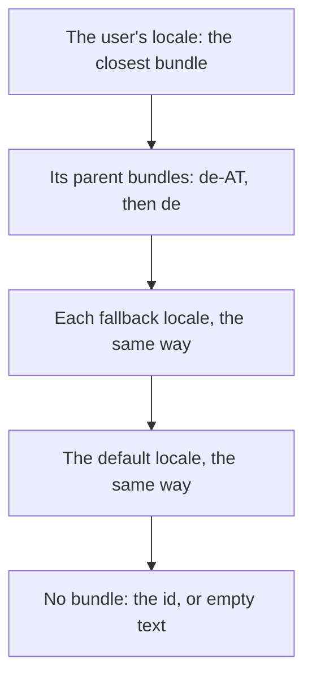

A `Translator` owns your bundles, the user's locale, a list of fallback locales and a default locale. `format(id, &args)` finds the message in the best bundle and formats it. You change the language with `set_locale`; nothing else changes.

```rust
use dxn_i18n::{Args, Bundle, Translator};
use dxn_intl::parse_locale;

let bundle = |tag: &str, json: &str| -> Result<Bundle, Box<dyn std::error::Error>> {
    let mut bundle = Bundle::new(parse_locale(tag)?);
    bundle.add_json(json)?;
    Ok(bundle)
};

let mut translator = Translator::new(parse_locale("en")?); // default locale
translator.add_bundle(bundle("en", r#"{ "hello": "Hello", "bye": "Goodbye" }"#)?);
translator.add_bundle(bundle("de", r#"{ "hello": "Hallo" }"#)?);
translator.add_bundle(bundle("de-AT", r#"{ "hello": "Servus" }"#)?);

translator.set_locale(parse_locale("de-AT")?);
assert_eq!(translator.format("hello", &Args::new()), "Servus");

translator.set_locale(parse_locale("de-CH")?); // no de-CH bundle: de is the closest
assert_eq!(translator.format("hello", &Args::new()), "Hallo");
assert_eq!(translator.format("bye", &Args::new()), "Goodbye"); // only the default has it
```

`Translator::new(default)` sets both the default and the first user locale. Bundles of the same locale added twice are merged, the later one replacing equal ids. The lookup chain is recomputed after every `add_bundle`, `set_locale` and `set_fallbacks`, so you can call them in any order.

## The lookup chain

For a message id, the translator tries bundles in this order and uses the first that has the message:



"The closest bundle" is [`dxn_intl::negotiate`](https://dxnsix.github.io/dXn.Intl/)'s pick among your bundles, which follows CLDR's fallback chain (`de-CH` to `de`, `zh-CN` to `zh-Hans`). If that bundle has a region and a bundle exists for the same locale without it, that one follows (`de-AT`, then `de`). `lookup_chain()` shows the result. With bundles `en`, `de`, `de-AT`, `pt-BR`, `pt` and `zh-Hans`, and `en` as the default:

| User's locale | Lookup chain |
|---|---|
| `de-AT` | `de-AT`, `de`, `en` |
| `de-CH` | `de`, `en` |
| `pt-BR` | `pt-BR`, `pt`, `en` |
| `pt-PT` | `pt`, `en` |
| `zh-CN` | `zh-Hans`, `en` |
| `zh-TW` | `en` (no Traditional Chinese bundle, and it is a different script) |
| `fr` | `en` |

```rust
use dxn_i18n::{Bundle, Translator};
use dxn_intl::parse_locale;

let mut translator = Translator::new(parse_locale("en")?);
for tag in ["en", "de", "de-AT"] {
    translator.add_bundle(Bundle::new(parse_locale(tag)?));
}
translator.set_locale(parse_locale("de-AT")?);

let chain: Vec<String> = translator.lookup_chain().iter().map(|locale| locale.to_string()).collect();
assert_eq!(chain, ["de-AT", "de", "en"]);
```

A bundle only counts if the locale matches. The chain contains the default locale's bundle only when you added one for it.

### Fallback locales

`set_fallbacks(vec![...])` inserts locales between the user's and the default, for languages that read alike: a Catalan user falls back to Spanish before English.

```rust
use dxn_i18n::{Args, Bundle, Translator};
use dxn_intl::parse_locale;

let mut translator = Translator::new(parse_locale("en")?);
for (tag, json) in [("en", r#"{ "hi": "Hi" }"#), ("es", r#"{ "hi": "Hola" }"#)] {
    let mut bundle = Bundle::new(parse_locale(tag)?);
    bundle.add_json(json)?;
    translator.add_bundle(bundle);
}
translator.set_fallbacks(vec![parse_locale("es")?]);
translator.set_locale(parse_locale("ca")?); // no ca bundle
assert_eq!(translator.format("hi", &Args::new()), "Hola");
```

## Which locale formats the values

Numbers, dates and plural rules in a message follow the language of the message, not always the user's locale:

- When the bundle that supplied the message has the same language as the user's locale, the **user's full locale** is used. A `de` message for a `de-CH` user formats `1234.5` as `1'234.5`.
- Otherwise the **bundle's locale** is used, with the user's `-u-` preferences added. An English fallback message for an Italian user formats numbers as English.

```rust
use dxn_i18n::{Args, Bundle, Translator};
use dxn_intl::parse_locale;

let mut translator = Translator::new(parse_locale("en")?);
for tag in ["en", "de"] {
    let mut bundle = Bundle::new(parse_locale(tag)?);
    bundle.add_json(r#"{ "price": "{$p :number}" }"#)?;
    translator.add_bundle(bundle);
}
let args = Args::new().with("p", 1234.5);

translator.set_locale(parse_locale("de-CH")?);
assert_eq!(translator.format("price", &args), "1'234.5");

translator.set_locale(parse_locale("it-u-nu-arab")?); // English text, the user's digits
assert_eq!(translator.format("price", &args), "١,٢٣٤.٥");
```

The reason is consistency inside one sentence: English text with Italian separators would read oddly. Arabic-Indic digits keep English separators because the English locale data has none of its own for that numbering system.

## User preferences

A language tag can carry Unicode extensions (`-u-` keys) that express personal preferences. They survive the lookup and apply to every number and date:

| Extension | Effect | Example tag |
|---|---|---|
| `-u-hc-h23` | 24-hour clock (also `h11`, `h12`, `h24`) | `en-US-u-hc-h23` |
| `-u-nu-arab` | Arabic-Indic digits (any CLDR numbering system) | `it-u-nu-arab` |
| `-u-ca-buddhist` | The Buddhist calendar | `en-u-ca-buddhist` |

```rust
use dxn_i18n::{Args, Bundle, Translator};
use dxn_intl::{DateTime, parse_locale};

let mut bundle = Bundle::new(parse_locale("en")?);
bundle.add("at", "At {$when :time}.")?;
let mut translator = Translator::new(parse_locale("en")?);
translator.add_bundle(bundle);

let args = Args::new().with("when", DateTime::new(2026, 10, 27, 15, 45, 0)?);
translator.set_locale(parse_locale("en-US")?);
assert_eq!(translator.format("at", &args), "At 3:45\u{202f}PM.");
translator.set_locale(parse_locale("en-US-u-hc-h23")?);
assert_eq!(translator.format("at", &args), "At 15:45.");
```

The library reads no system settings. Your app gets the user's tag from the platform and passes it to `parse_locale`, which also accepts POSIX forms such as `pt_BR.UTF-8` (read as `pt-BR`). Pick the preference extensions from your own settings screen the same way.

## Missing messages

An id no bundle in the chain has formats as the id by default, so a gap is visible and the screen still reads. Change it with `set_missing_message`:

```rust
use dxn_i18n::{Args, MissingMessage, TranslateError, Translator};
use dxn_intl::parse_locale;

let mut translator = Translator::new(parse_locale("en")?);
assert_eq!(translator.format("cart.title", &Args::new()), "cart.title");

translator.set_missing_message(MissingMessage::Empty);
assert_eq!(translator.format("cart.title", &Args::new()), "");

assert!(!translator.contains("cart.title"));
assert_eq!(
    translator.try_format("cart.title", &Args::new()),
    Err(TranslateError::Missing("cart.title".to_string()))
);
```

`contains(id)` asks whether a bundle in the chain has the message. [Errors and fallbacks](./errors.md) covers `try_format`.

## Settings and sharing

| Method | Sets |
|---|---|
| `set_functions(Arc<FunctionRegistry>)` | The functions messages can call ([Custom functions](./custom-functions.md)). |
| `set_bidi_isolation(BidiIsolation)` | Whether placeholders are isolated ([Text direction](./bidi.md)). |
| `set_missing_message(MissingMessage)` | What a missing message shows. |
| `available_locales()`, `bundles()` | The locales and bundles added, in order. |
| `locale()`, `default_locale()` | The user's and the default locale. |

`Translator` is `Clone`, `Send` and `Sync`, and `format` takes `&self`, so a shared translator can serve many threads; changing the language needs `&mut self`. [Cookbook](./cookbook.md#share-one-translator-between-threads) shows an `Arc<RwLock<_>>`.

Next: [Arguments and values](./arguments.md), or [Errors and fallbacks](./errors.md).
